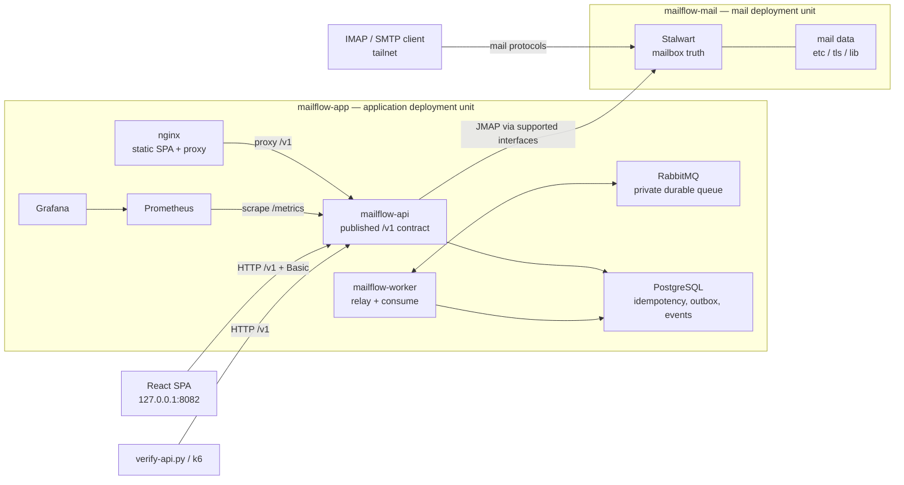
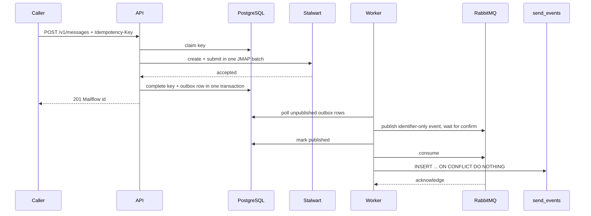

# Architecture and infrastructure

A one-page reference for walking through the system during a presentation. It
answers four questions: **who owns what**, **what talks to what**, **where the
state lives**, and **which check proves each claim**.

For the behavior contract itself, see [`docs/api.md`](docs/api.md) and the specs
in `openspec/specs/`.

## 1. The one-sentence version

Stalwart owns mailbox truth; the Go service owns the only published HTTP
contract; PostgreSQL owns application state only; an outbox and RabbitMQ carry
identifier-only send events to a Go worker; Prometheus and Grafana observe the
service without ever seeing mail content.

## 2. System context

The browser never speaks IMAP, JMAP, or SMTP. It uses the same `/v1` contract as
the verifier and the load generator. An application deploy replaces only the
right-hand unit; the mail unit is never recreated, upgraded, or reset.

## 3. State ownership

| Component | Owns | Never owns |
|---|---|---|
| Stalwart | Messages, folders, flags, authentication | Application records |
| PostgreSQL | Idempotency records, outbox rows, consumed `send_events` | Mailbox contents |
| RabbitMQ | Delivery of identifier-only events | Any mail or projection state |
| Go service | The published contract and translation | A second mailbox store |
| React client | Credentials in memory for one session | Passwords in browser storage |

Mailflow IDs encode the account and are opaque; raw mail server identifiers and
protocol vocabulary never appear in public JSON. The replaceability checklist
is enforced by response scans in `verify-api.py`, not by convention.

## 4. A send, end to end

Two properties matter here:

- **A replay cannot send twice.** The key is claimed before the mail server is
  called, and the result is recorded under that key.
- **The broker is not in the send path.** If RabbitMQ is down, outbox rows stay
  unpublished and sends keep working; the worker retries on its next bounded
  poll. Consumption is at least once and idempotent by outbox id.

Drafts and replies follow the same rules: submission of a draft reuses the
idempotency record; draft creation and reply composition do not.

## 5. Reads, search, and attachments

- **Message reads** translate Mailflow IDs back to server IDs, check the
  account segment, then fetch with an explicit property list so vendor detail
  cannot leak into the DTO.
- **Search** builds one upstream `Email/query` with a text filter and optional
  mailbox, then uses the same page and cursor model as listing.
- **Attachments** are addressed by message ID plus position. The metadata read
  is explicit; the download uses the session's HTTPS template, rewrites only the
  host to the configured JMAP endpoint, and streams bounded bytes with
  `Content-Length`, `no-store`, and `nosniff`.

No value from a mail protocol header reaches a public response. Threading for
replies is set in header form upstream and read back only as derived fields.

## 6. Networks, ports, and volumes

| Network | Members | Purpose |
|---|---|---|
| `mailflow-mail_default` | Stalwart | IMAP, SMTP, HTTPS/JMAP |
| `mailflow-app-data` (internal) | api, db, web, worker, rabbitmq, prometheus, grafana | Private application traffic |
| `mailflow-app-frontend` | web, prometheus, grafana | Carries loopback-published ports |

| Published address | Service |
|---|---|
| `127.0.0.1:993`, `:465`, `:443`, `:8089` | Mail protocols and management |
| `127.0.0.1:8081` | Go API (`/v1`, `/metrics`, `/healthz`) |
| `127.0.0.1:8082` | React client |
| `127.0.0.1:9090`, `:3000` | Prometheus, Grafana |

The database and RabbitMQ publish nothing. Mail state lives in host bind mounts
under `deploy/mail/data/`; application state lives in the named volumes
`mailflow-app-ca`, `mailflow-app-db`, `mailflow-app-rabbit`, and
`mailflow-app-prometheus`. Prometheus and Grafana configs are baked into derived
images, so the Compose project has no bind mounts — the self-hosted runner's
checkout is not visible to the host Docker daemon.

## 7. Observability and load

OpenTelemetry instruments HTTP handlers with route patterns and status codes as
the only labels. Prometheus scrapes `/metrics`; Grafana ships a provisioned
"Mailflow API" dashboard for request rate, 5xx rate, and p95. Tracing is
optional OTLP export. The manual load workflow generates a bounded, read-only
spike without adding any dashboard or exporter configuration.

The outbox, RabbitMQ, and worker are deliberately not traced; their state is
verified with database counts during integration checks. This is documented as
a gap rather than implied coverage.

## 8. Claim → check map

| Claim | Check |
|---|---|
| Contract behavior | `./app/scripts/verify-api.py --base http://127.0.0.1:8081` |
| Service correctness | `./app/scripts/go.sh` |
| Spec coherence | `openspec validate --all --strict` |
| Client builds and tests | `npm run build && npm test` in `web/` |
| Deployment safety | `deploy-app.yml` asserts the mail container is unchanged |
| Capacity spike | manual "Load test — mailflow API" workflow, then Grafana |

Every archived change under `openspec/changes/archive/` keeps its proposal,
design, tasks, and verification result, so the sequence of decisions is visible
without relying on this diagram.
